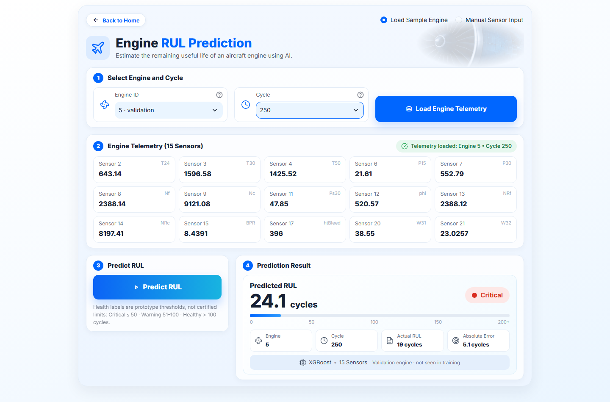
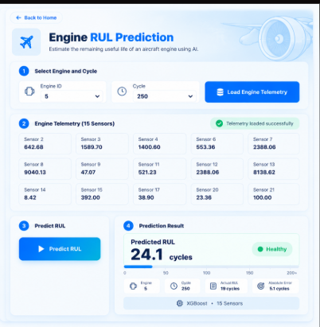

# NASA C-MAPSS FD001 — Aircraft Engine RUL Prediction

Predicting the **Remaining Useful Life (RUL)** of turbofan engines from multivariate sensor telemetry, using the NASA C-MAPSS FD001 run-to-failure dataset, an XGBoost regressor, leakage-safe engine-level validation and a Streamlit prediction interface.

> Personal portfolio project. The goal is an honest, reproducible end-to-end predictive-maintenance workflow, from raw telemetry to a working prediction app, not a leaderboard score.

## Overview

Unplanned engine failures are expensive and safety-critical, while replacing parts on a fixed schedule wastes useful life. **Predictive maintenance** sits between the two: it estimates how much life an asset has left from its condition data, so maintenance can be planned before failure.

This project builds that estimate for simulated aircraft engines. Given an engine's sensor readings at a given operating cycle, the model predicts how many cycles remain before the engine reaches end of life.

## Project Highlights

- **Data:** NASA C-MAPSS FD001, with 100 training engines (run to failure), 100 test engines (truncated before failure) and 21 sensors.
- **Features:** 15 sensors kept after removing the 6 sensors that are constant in FD001.
- **Model:** XGBoost regression, tuned with `GroupKFold` cross-validation on engines.
- **Leakage-safe validation:** the train/validation split is made **by engine**, never by random rows.
- **Official benchmark:** evaluated once on the official NASA FD001 test set (`test_FD001.txt` + `RUL_FD001.txt`).
- **Integrity checks:** the model is checked against a SHA-256 fingerprint, its expected type and the 15-feature order before it is served.
- **Experiments:** documented, reproducible follow-up experiments (RUL capping, rolling and trend features, test-like validation), kept separate from the production model.
- **App:** a two-page Streamlit app for engine/cycle selection or manual sensor input.
- **Tests:** 52 automated tests covering data loading, the model service, official evaluation, the experiments and the Streamlit app.

## Problem

Each engine is observed over many operating cycles. At every cycle the data records the engine ID, the cycle number, three operational settings and 21 sensor measurements.

**Task:** given an engine's telemetry, estimate how many operating cycles remain before failure.

For training engines, which run until failure:

```text
RUL = max_cycle(engine) - current_cycle
```

For example, an engine whose last cycle is 192 has RUL 191 at cycle 1, RUL 92 at cycle 100 and RUL 0 at cycle 192. The target is used uncapped.

## Dataset

[C-MAPSS](#acknowledgements) (Commercial Modular Aero-Propulsion System Simulation) is NASA's simulated turbofan degradation dataset. According to NASA's readme, **FD001** has 100 training and 100 test trajectories, **one operating condition (sea level)** and **one fault mode (HPC degradation)**.

| File | Contents |
|---|---|
| `data/raw/train_FD001.txt` | 20,631 rows; every engine runs until failure |
| `data/raw/test_FD001.txt` | 13,096 rows; each engine stops some time before failure (31–303 observed cycles) |
| `data/raw/RUL_FD001.txt` | True RUL at the last observed cycle of each test engine (7–145 cycles) |
| `data/CMAPSSData.zip` | Original NASA archive (all four subsets, readme and reference paper) |

Each file has 26 whitespace-separated columns: `engine_id`, `cycle`, `setting_1`–`setting_3` and `sensor_1`–`sensor_21`. [`src/data_loader.py`](src/data_loader.py) loads the files and validates their structure (column count, numeric types, missing values, duplicates, engine IDs and cycle ordering).

## Methodology

```text
Raw telemetry
  → data loading and validation
  → constant-sensor removal
  → RUL target construction
  → engine-level train/validation split (80 / 20 engines)
  → feature preparation (15 raw sensors, no scaling)
  → XGBoost regression (GroupKFold-tuned)
  → validation on held-out engines
  → one-time evaluation on the official NASA test set
```

- **Engine-level split.** Rows from one engine are strongly correlated. A random row split would put cycles of the same engine in both training and validation and overstate accuracy. The split is `GroupShuffleSplit(test_size=0.2, random_state=42)` grouped by `engine_id`, giving 80 training engines (16,561 rows) and 20 validation engines (4,070 rows).
- **Tuning.** `RandomizedSearchCV` with 20 candidates, using 3-fold `GroupKFold` on the training engines only and MAE as the score.
- **No test-set tuning.** The official test set was used only for final evaluation.

## Selected Features

The model uses these 15 sensors, in this exact order:

```text
sensor_2   sensor_3   sensor_4   sensor_6   sensor_7
sensor_8   sensor_9   sensor_11  sensor_12  sensor_13
sensor_14  sensor_15  sensor_17  sensor_20  sensor_21
```

Six sensors (`sensor_1`, `sensor_5`, `sensor_10`, `sensor_16`, `sensor_18`, `sensor_19`) take a single constant value across the FD001 training data, so they carry no information and were removed. The operational settings are not model inputs.

## Model

The production model is the **V1 baseline**: an `XGBRegressor` trained on raw (unscaled) values of the 15 sensors. Its predictions are clipped at 0.

| Hyperparameter | Value |
|---|---|
| `n_estimators` | 400 |
| `max_depth` | 4 |
| `learning_rate` | 0.01 |
| `subsample` | 0.7 |
| `colsample_bytree` | 0.7 |
| `min_child_weight` | 5 |
| `gamma` | 0.1 |

The model file, feature list, hyperparameters, split and validation metrics are recorded in [`models/model_metadata.json`](models/model_metadata.json). [`src/model_service.py`](src/model_service.py) refuses to serve a model whose fingerprint, type or feature order does not match that record.

## Results

### Validation (20 held-out engines, every cycle)

| Model | Features | MAE | RMSE | R² |
|---|---|---|---|---|
| **V1 — production** | 15 | **25.8786** | **35.1955** | **0.7126** |
| Phase 2 candidate (experimental) | 57 | 24.6624 | 33.6179 | 0.7378 |

### Official NASA FD001 test (100 engines, last observed cycle)

| Model | MAE | RMSE | R² | Median abs. error | Mean bias |
|---|---|---|---|---|---|
| **V1 — production** | **23.0814** | **31.4737** | **0.4264** | 16.8350 | +19.3512 |
| Phase 2 candidate (experimental) | 22.9891 | 30.8501 | 0.4489 | 15.6653 | +19.3755 |

The Phase 2 model scored slightly better on the official test, but the improvement was small: MAE fell by 0.09 cycles and RMSE by 0.62. It also needs 57 features instead of 15, plus history-based feature engineering at prediction time, and it leaves the positive bias unchanged. **V1 therefore remains the production model.**

Sources: [`results/official_test_metrics.json`](results/official_test_metrics.json), [`results/phase2_experiments.json`](results/phase2_experiments.json) and [`results/phase2_official_test_metrics.json`](results/phase2_official_test_metrics.json).

## Official Test Evaluation

The standard FD001 benchmark makes **one prediction per test engine at its last observed cycle** and compares it with the matching value in `RUL_FD001.txt`. [`src/evaluate_official_test.py`](src/evaluate_official_test.py) scores the exact model served by the app this way. It saves the metrics, an error breakdown by true-RUL band and a supplementary all-rows view to `results/`.

On this benchmark V1 achieves **MAE 23.0814, RMSE 31.4737 and R² 0.4264**. Its mean bias is **+19.35 cycles**: on average it predicts more remaining life than the engines actually have.

## Phase 2 Experiments

These experiments were run after V1 was finalized. Each compares against the exact V1 configuration, uses the same engine split and is scored on validation data only. Each candidate was scored on the official test once, only after it was selected. None of them replaced V1.

**Phase 2 — feature and target experiments** ([`src/phase2_experiments.py`](src/phase2_experiments.py), [`results/phase2_comparison.csv`](results/phase2_comparison.csv)):

| Experiment | Features | Validation MAE | RMSE | R² |
|---|---|---|---|---|
| V1 baseline (refit, identical to saved model) | 15 | 25.8786 | 35.1955 | 0.7126 |
| RUL cap 125 (training labels only) | 15 | 31.9717 | 45.9839 | 0.5094 |
| RUL cap 100 | 15 | 38.6479 | 55.6788 | 0.2807 |
| RUL cap 75 | 15 | 49.1703 | 68.9620 | −0.1034 |
| Rolling mean/std (windows 5, 10) | 39 | 24.8502 | 33.8955 | 0.7334 |
| Trend features (diff, slope, change) | 33 | 25.6192 | 34.8040 | 0.7190 |
| **Combined: rolling + trend** | 57 | **24.6624** | **33.6179** | **0.7378** |

- **Feature windows.** Rolling and trend features are computed per engine from current and past cycles only, for the 6 sensors most correlated with RUL on the training engines.
- **Capping.** RUL capping made full-life validation worse, because a capped model cannot predict long remaining lives.

**Phase 2.5 — test-like validation** ([`src/phase2_5_test_like_validation.py`](src/phase2_5_test_like_validation.py), [`results/phase2_5_comparison.csv`](results/phase2_5_comparison.csv)):

Full-life validation does not resemble the benchmark, which scores one truncated observation per engine. Phase 2.5 therefore cuts each validation engine at 60/70/80/90% of its life (80 samples), predicts once at the cut and re-tests RUL capping.

| Model | MAE | RMSE | R² | Mean bias |
|---|---|---|---|---|
| No cap (V1 configuration) | 21.3005 | 30.9959 | −0.4865 | +15.9329 |
| Cap 150 | 18.1098 | 25.2378 | 0.0145 | +12.7667 |
| Cap 125 | 15.4548 | 20.9953 | 0.3180 | +10.2845 |
| Cap 100 | 12.5834 | 16.4996 | 0.5788 | +6.1442 |
| Cap 75 | 11.4006 | 14.8482 | 0.6589 | −0.3337 |

In this setting capping clearly reduces error and over-prediction for engines with RUL up to about 150. But because a capped model cannot predict above its cap, errors for engines with RUL > 150 grow sharply. Pooled over three truncation schedules, MAE in that band rises from 25.37 (no cap) to 52.84 with cap 125. No cap passed every pre-registered selection rule, so no official-test run was made and no capped model was adopted.

## Streamlit App

The app ([`app.py`](app.py)) serves the V1 model through two pages:

1. **Home:** a short introduction to the project and a **Go to Prediction** button.
2. **Prediction:** there are two input modes.
   - **Load Sample Engine:** pick an engine and cycle from the FD001 training file, load its 15-sensor telemetry and predict RUL. The result shows the actual RUL, the absolute error and whether the engine was held out for validation or seen in training.
   - **Manual Sensor Input:** type in all 15 sensor values. Inputs are validated: non-positive values are rejected, and values outside the training range are flagged.

Predictions get a health label (Critical ≤ 50, Warning 51–100, Healthy > 100 cycles). These thresholds are demo display conventions, not certified maintenance limits.

### Application Preview

Screenshots of the running app at a 1440 px wide browser window. The prediction page shows validation engine 5 at cycle 250: predicted RUL 24.1 cycles against an actual RUL of 19.

| Home | Prediction |
|---|---|
|  |  |

### Design References

These are the design mockups the interface was built from, not screenshots of the app:

| Home (mockup) | Prediction (mockup) |
|---|---|
|  |  |

## Project Structure

```text
NASA-CMAPSS-RUL-Prediction/
├── app.py                         # Streamlit app (serves the V1 model)
├── requirements.txt               # Runtime dependencies (pinned)
├── requirements-notebooks.txt     # Extra packages for the notebooks
├── PROJECT_GUIDE.md               # Original project planning notes
├── .streamlit/config.toml         # App theme
├── assets/                        # Hero image, app screenshots and design mockups
├── data/
│   ├── CMAPSSData.zip             # Original NASA archive
│   └── raw/                       # train_FD001.txt, test_FD001.txt, RUL_FD001.txt
├── models/
│   ├── xgboost_rul_model.pkl      # V1 production model
│   ├── model_metadata.json        # V1 fingerprint, features, split, metrics
│   ├── feature_names.pkl
│   ├── scaler.pkl                 # Used only by the notebook's linear-regression baseline
│   ├── phase2_best_model.pkl      # Phase 2 candidate (experimental, not served)
│   └── phase2_model_metadata.json
├── notebooks/
│   ├── 01_EDA_FD001.ipynb         # Initial exploratory analysis
│   ├── 02_EDA_FD001.ipynb         # Earlier version of the EDA notebook
│   └── 02_EDA_FD001_cleaned.ipynb # Final EDA, model comparison, tuning and export
├── results/                       # Official-test and experiment metrics
├── src/
│   ├── data_loader.py             # Loading and validation of C-MAPSS files
│   ├── model_service.py           # Verified model loading, prediction, input checks
│   ├── predict.py                 # Minimal prediction entry point
│   ├── evaluate_official_test.py  # Official FD001 benchmark evaluation
│   ├── phase2_experiments.py      # Phase 2 experiments
│   └── phase2_5_test_like_validation.py  # Phase 2.5 test-like validation
└── tests/                         # 52 unittest tests
```

## Installation

You need Python 3.12. On Windows:

```powershell
git clone <repository-url>
cd NASA-CMAPSS-RUL-Prediction

python -m venv .venv
.venv\Scripts\activate

pip install -r requirements.txt
```

On macOS/Linux, activate with `source .venv/bin/activate` instead. To run the notebooks as well, install `requirements-notebooks.txt`.

Dependency versions are pinned on purpose: the saved `.pkl` models are only guaranteed to load with the same scikit-learn and XGBoost versions that created them.

## Run the App

```powershell
python -m streamlit run app.py
```

## Run Tests

```powershell
python -m unittest discover -s tests
```

Expected: `Ran 52 tests ... OK`.

## Reproduce the Official Evaluation

```powershell
python -m src.evaluate_official_test
```

This rewrites `results/official_test_metrics.json` and `results/official_test_predictions.csv` with the same metrics; only the `evaluated_at_utc` timestamp changes.

## Reproduce the Experiments

These scripts are **experiments only**. They never modify or replace the production model.

```powershell
python -m src.phase2_experiments               # Phase 2 (about 2 minutes)
python -m src.phase2_5_test_like_validation    # Phase 2.5 (about 2 minutes)
```

Both are deterministic. Re-running them reproduces their result files, and the Phase 2 model file, byte for byte.

## Limitations

- **One subset only.** Only FD001 (one operating condition, one fault mode) is used; results do not carry over to FD002–FD004.
- **Small validation set.** Validation uses 20 held-out engines, so small metric differences are within noise.
- **Moderate official-test R².** R² is 0.4264, and predictions jump around from cycle to cycle because the model sees one cycle at a time.
- **Positive bias.** On the official test V1 over-predicts by about 19 cycles on average, which is the risky direction for maintenance.
- **Phase 2 trade-off.** The Phase 2 model improves metrics only slightly and needs each engine's recent history to build its features.
- **Capping trade-off.** RUL capping helps engines with lower remaining life but causes large under-prediction for engines with high remaining life.
- **Demo thresholds.** The app's health labels are illustrative, not certified maintenance limits.

## Future Work

- More robust temporal feature engineering
- Evaluation on the other C-MAPSS subsets (FD002–FD004)
- Sequence models such as LSTMs or Transformers
- Uncertainty estimates for predictions
- Better degradation modelling, for example health-state or piecewise targets chosen with a benchmark-like validation

## Acknowledgements

Dataset: NASA C-MAPSS turbofan engine degradation simulation data. Reference: A. Saxena, K. Goebel, D. Simon and N. Eklund, "Damage Propagation Modeling for Aircraft Engine Run-to-Failure Simulation", *Proceedings of the 1st International Conference on Prognostics and Health Management (PHM08)*, Denver, CO, 2008.
